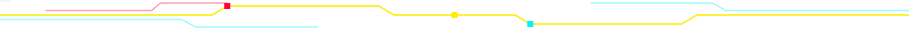

<!--
  ============================================================
  VENTURA // NIGHT CITY PROFILE
  Arquivos necessários neste repositório (cVenturaDev/cVenturaDev):
    - README.md
    - assets/banner.svg
    - assets/divider.svg
  ============================================================
-->

<div align="center">

<!-- BANNER: animado (chuva, glitch, neon). Arquivo local: assets/banner.svg -->


<!-- TERMINAL LOG: troque as linhas em "lines=" (separe com ; e use + no lugar de espaço) -->
<a href="https://github.com/cVenturaDev">
  
</a>

</div>



<!-- ============================================================ -->
<!-- 02 // IDENTIDADE                                              -->
<!-- ============================================================ -->

## ◢ IDENTITY FILE

```ini
[ SYSTEM ONLINE ]
IDENTITY       = VENTURA
OCCUPATION     = DEVELOPER IN PROGRESS
SPECIALIZATION = SOFTWARE DEVELOPMENT / WEB / HARDWARE
STATUS         = LEARNING, BUILDING AND BREAKING LIMITS
```

```ini
[ LOG ]
> scanning interests ............ programming, web, tech, hardware
> neural link ................... stable
> next objective ................ ship more code
```


<!-- ============================================================ -->
<!-- 03 // ARSENAL                                                 -->
<!-- ============================================================ -->

## ◢ ARSENAL // CYBERWARE INSTALLED

<!-- Para adicionar uma tecnologia, copie um badge e troque o nome e o "logo=" (slugs em simpleicons.org).
     Cores: logoColor=FCEE0A (amarelo) | 00F0FF (ciano) | FF003C (magenta) | F5F5F5 (branco) -->

<table>
  <tr>
    <td><code>LANGUAGES</code></td>
    <td>
      
      
      
      
    </td>
  </tr>
  <tr>
    <td><code>FRONTEND</code></td>
    <td>
      
      
      
      
    </td>
  </tr>
  <tr>
    <td><code>BACKEND</code></td>
    <td>
      
      
    </td>
  </tr>
  <tr>
    <td><code>TOOLS</code></td>
    <td>
      
      
      
      
    </td>
  </tr>
  <tr>
    <td><code>INFRASTRUCTURE</code></td>
    <td>
      
      
    </td>
  </tr>
  <tr>
    <td><code>INTERESTS</code></td>
    <td>
      
      
      
    </td>
  </tr>
</table>


<!-- ============================================================ -->
<!-- 04 // PROJETOS                                                -->
<!-- ============================================================ -->

## ◢ NIGHT CITY DATABASE // MISSIONS LOG

`[ DATABASE CONNECTED ]`

<!--
  COMO EDITAR UMA MISSÃO:
  1. Troque o nome, a descrição e as tecnologias.
  2. Troque o link do botão por: https://github.com/cVenturaDev/NOME-DO-REPOSITORIO
     (por padrão ele aponta para sua aba de repositórios, que funciona).
  3. Troque o badge de status copiando UM destes:

  COMPLETED:
  https://img.shields.io/badge/STATUS-COMPLETED-00F0FF?style=flat-square&labelColor=1A1A1A
  IN DEVELOPMENT:
  https://img.shields.io/badge/STATUS-IN_DEVELOPMENT-FCEE0A?style=flat-square&labelColor=1A1A1A
  CLASSIFIED:
  https://img.shields.io/badge/STATUS-CLASSIFIED-FF003C?style=flat-square&labelColor=1A1A1A

  Para criar uma nova missão, copie um bloco <table> inteiro e cole abaixo do último.
-->

<!-- ===== MISSION 001 ===== -->
<table>
  <tr>
    <td>
      <code>MISSION 001</code> &nbsp;
      <br><br>
      <b>[ Monitor TJSP ]</b><br>
      <sub>Uma ferramenta com o propósito de facilitar a vida do advogado ao monitorar seus processos de forma mais simples</sub><br><br>
      <br><br>
      <a href="https://github.com/cVenturaDev/Monitor-TJSP"><code>[ ACCESS REPOSITORY ]</code></a>
    </td>
  </tr>
</table>

<!-- ===== MISSION 002 ===== -->
<table>
  <tr>
    <td>
      <code>MISSION 002</code> &nbsp;
      <br><br>
      <b>[ PROJECT_NAME ]</b><br>
      <sub>Short description of the mission objective. Replace this text.</sub><br><br>
      <br><br>
      <a href="https://github.com/cVenturaDev?tab=repositories"><code>[ ACCESS REPOSITORY ]</code></a>
    </td>
  </tr>
</table>

<!-- ===== MISSION 003 ===== -->
<table>
  <tr>
    <td>
      <code>MISSION 003</code> &nbsp;
      <br><br>
      <b>[ PROJECT_NAME ]</b><br>
      <sub>Short description of the mission objective. Replace this text.</sub><br><br>
      <br><br>
      <a href="https://github.com/cVenturaDev?tab=repositories"><code>[ ACCESS REPOSITORY ]</code></a>
    </td>
  </tr>
</table>


<!-- ============================================================ -->
<!-- 05 // ESTATÍSTICAS                                            -->
<!-- ============================================================ -->

## ◢ NETRUNNER STATISTICS

`[ ACCESS GRANTED ]`

<!--
  Os cards abaixo são gerados em tempo real pelos serviços públicos
  GitHub Readme Stats e GitHub Streak Stats, usando apenas dados reais da sua conta.
  Se algum card falhar ao carregar, é uma instabilidade temporária do serviço.
  Repositórios privados só entram na contagem se você ativar isso nas configurações do seu perfil.
-->

<div align="center">


</div>


<!-- ============================================================ -->
<!-- 06 // CONTATOS                                                -->
<!-- ============================================================ -->

## ◢ ESTABLISH CONNECTION

<!--
  CAMPOS A PREENCHER (badges magenta "FILL ME" = ainda não configurado):
  - LinkedIn:  troque YOUR_LINKEDIN_USERNAME no href e troque o badge por:
               https://img.shields.io/badge/LINKEDIN-SEU_NOME-00F0FF?style=for-the-badge&labelColor=1A1A1A
  - Instagram: troque YOUR_INSTAGRAM_USERNAME no href e troque o badge por:
               https://img.shields.io/badge/INSTAGRAM-@seu_usuario-00F0FF?style=for-the-badge&labelColor=1A1A1A
  - E-mail:    troque YOUR_EMAIL_ADDRESS no href e troque o badge por:
               https://img.shields.io/badge/E--MAIL-seu@email.com-00F0FF?style=for-the-badge&labelColor=1A1A1A
-->

<div align="center">

<a href="https://github.com/cVenturaDev"></a>
<a href="https://www.linkedin.com/in/YOUR_LINKEDIN_USERNAME"></a>
<a href="https://www.instagram.com/YOUR_INSTAGRAM_USERNAME"></a>
<a href="mailto:YOUR_EMAIL_ADDRESS"></a>

</div>


<!-- ============================================================ -->
<!-- 07 // ENCERRAMENTO                                            -->
<!-- ============================================================ -->

<div align="center">

```ini
[ UPLINK TERMINATED ]
> session closed ................ ok
> connection logged ............. ok
[ END OF TRANSMISSION ]
```

**`BUILT IN THE CITY OF DREAMS. POWERED BY CODE.`**

</div>
